# 数值仿真算例 {#sec:sim}

本节通过两个代表性算例定量检验无迹变换与无迹滤波的实际性能：其一为雷达与移动机器人感知中无处不在的极坐标到直角坐标变换；其二为文献 [@r06,r08] 中的五维高超声速再入飞行器地面雷达追踪基准问题。所有图形与数值均由确定性复现脚本生成。

## 算例一：极坐标到直角坐标变换 {#sec:sim-polar}

考虑传感器在极坐标系下测得目标距离 $r$ 与方位角 $\theta$，并向平面直角坐标 $(x, y)$ 映射的经典非线性变换：
$$ {#eq:19}
x = r \cos\theta, \qquad y = r \sin\theta
$$
设极坐标输入服从相互独立的正态分布：$r \sim \mathcal{N}(1, 0.02^2)$，$\theta \sim \mathcal{N}(\pi/2, (15^\circ)^2)$（即 $\sigma_\theta = 15\pi/180 \approx 0.2618\text{ rad}$）。由于方位角不确定性较大，变换后的真实概率分布呈明显的弧形（「香蕉形」）向原点内侧弯折。由正态特征函数可直接求得该变换的解析真实均值与协方差：
$$ {#eq:20}
\mathbb{E}[x] = 0, \qquad \mathbb{E}[y] = \bar{r}\exp\Bigl(-\frac{\sigma_\theta^2}{2}\Bigr) \approx 0.96631
$$
真实标准差为 $(\sigma_x, \sigma_y) = (0.25313, 0.05068)$。

一阶线性化方法在均值点 $(1, \pi/2)$ 处直接代入函数并计算一阶偏导数矩阵，给出近似均值 $\bar{\bm{y}}_{\text{lin}} = (0, 1.00000)^{\mathrm{T}}$ 与标准差 $(\sigma_{x,\text{lin}}, \sigma_{y,\text{lin}}) = (0.26180, 0.02000)$：其均值完全丢失弧形弯折带来的向下偏移（均值误差达 $0.03369$），纵向标准差更被严重低估至真实值的 $39.5\%$（协方差矩阵范数误差为 $4.96 \times 10^{-3}$）。

相比之下，取 $n = 2$、$\kappa = 1$（满足式 ({@eq:16|n}) 的 $n + \kappa = 3$）构造 $5$ 组对称采样点执行无迹变换，所得估计均值为 $(0, 0.96631)^{\mathrm{T}}$（均值误差低于 $10^{-5}$），估计标准差为 $(0.25292, 0.05167)$，协方差范数误差骤降至 $0.15 \times 10^{-3}$，精度较一阶线性化提升超过 $33$ 倍。{@fig:1} 直观对比了真实样本云、解析 $1\sigma$ 误差椭圆、一阶线性化椭圆与无迹变换椭圆；{@fig:2} 进一步展示了缩放参数 $\kappa \in [-1.2, 4.0]$ 变化时无迹变换协方差逼近误差的演化曲线，清晰验证了在 $n + \kappa = 3$（即 $\kappa = 1$）处取得全局极小误差。

{#fig:1}

{#fig:2}

## 算例二：高超声速再入飞行器地面雷达追踪 {#sec:sim-reentry}

为检验完整递推滤波器在强非线性动力学与非线性观测双重耦合下的表现，考虑高超声速弹道飞行器重返地球大气层的二维地心追踪问题 [@r06,r08]。系统状态向量为五维向量 $\bm{x}(t) = \bigl(x_1(t), x_2(t), x_3(t), x_4(t), x_5(t)\bigr)^{\mathrm{T}}$，依次表示飞行器的地心横向与纵向位置（单位 $\text{km}$）、对应速度分量（单位 $\text{km/s}$）以及未知的归一化气动弹道参数 $x_5$。连续时间动力学方程为：
$$ {#eq:21}
\begin{aligned}
\dot{x}_1(t) &= x_3(t), & \dot{x}_2(t) &= x_4(t) \\
\dot{x}_3(t) &= D(t) x_3(t) + G(t) x_1(t) + w_1(t), & \dot{x}_4(t) &= D(t) x_4(t) + G(t) x_2(t) + w_2(t) \\
\dot{x}_5(t) &= w_3(t)
\end{aligned}
$$
其中与高度指数相关的气动阻力系数 $D(t)$ 与反平方中心引力项 $G(t)$ 分别为：
$$ {#eq:22}
D(t) = \beta_0 \exp\bigl(x_5(t)\bigr) \exp\!\left(\frac{R_0 - R(t)}{H_0}\right) V(t), \qquad G(t) = -\frac{G m_0}{R(t)^3}
$$
这里地心距 $R(t) = \sqrt{x_1^2 + x_2^2}$，速度模 $V(t) = \sqrt{x_3^2 + x_4^2}$，地球物理常数取 $R_0 = 6374\text{ km}$、大气标高 $H_0 = 13.406\text{ km}$、地球引力常数 $G m_0 = 3.9860 \times 10^5\text{ km}^3/\text{s}^2$、名义弹道系数 $\beta_0 = -0.59783$。地面雷达位于地心坐标 $(x_r, y_r) = (6374, 0)\text{ km}$ 处，以采样周期 $\Delta t = 1.0\text{ s}$ 观测斜距与仰角：
$$ {#eq:23}
r_k = \sqrt{(x_{1,k} - x_r)^2 + (x_{2,k} - y_r)^2} + v_{r,k}, \qquad \theta_k = \operatorname{atan2}(x_{2,k} - y_r, x_{1,k} - x_r) + v_{\theta,k}
$$
观测噪声标准差取 $\sigma_r = 0.05\text{ km}$、$\sigma_\theta = 0.025\text{ rad}$，速度过程噪声强度 $q_v = 2.4064 \times 10^{-5}\text{ km}^2/\text{s}^3$。飞行器真实初态为 $\bm{x}_0 = (6500.4, 349.14, -1.8093, -6.7967, 0.6932)^{\mathrm{T}}$；两类滤波器均采用存在位置、速度及弹道参数初偏的同一先验 $\hat{\bm{x}}_0 = (6501.4, 348.14, -1.7593, -6.8467, 0)^{\mathrm{T}}$ 与协方差 $\bm{P}_0 = \operatorname{diag}(2.0, 2.0, 0.02, 0.02, 1.5)$ 初始化。其中无迹滤波取 $\kappa = 0$（共 $11$ 个非负权重采样点），直接将采样点经四阶显式数值积分推进，全程无需任何偏导数矩阵。

{@fig:3} 展示了飞行器 $160\text{ s}$ 内的地心再入轨迹与地面雷达几何关系。当飞行器在 $t \in [10, 40]\text{ s}$ 穿过高空稀薄大气进入稠密大气层时，指数型气动阻力急剧放大，动力学与观测同时进入强非线性区段。

{#fig:3}

在 20 次独立随机仿真统计下，{@fig:4} 与{@fig:5} 分别给出了位置与速度估计均方根误差随时间的演化对比。在强气动减速段（$t \approx 15\text{--}35\text{ s}$），一阶线性化滤波因忽略指数阻力的二阶及以上曲率，位置均方根误差峰值飙升至 $1.5897\text{ km}$（$t = 25\text{ s}$ 时为 $1.4749\text{ km}$），全时域均值 $0.6089\text{ km}$；而无迹滤波将峰值误差压低至 $1.4342\text{ km}$（$t = 25\text{ s}$ 时降至 $1.2332\text{ km}$，降幅达 $16.4\%$），全时域均值降至 $0.5786\text{ km}$。

{#fig:4}

{#fig:5}

更显著的差异体现在未知气动弹道参数 $x_5$ 的辨识过程（{@fig:6}）：在 $t = 17\text{ s}$ 气动阻力初显的瞬态阶段，一阶线性化滤波对 $x_5$ 产生了剧烈超调（冲高至 $0.909$，相对真实值 $0.6932$ 偏差 $+0.216$），而无迹滤波平稳攀升至 $0.654$（偏差仅 $-0.039$，瞬态超调缩减超过 $5$ 倍），随后紧贴真实参数值稳定收敛，且真实值全程位于无迹滤波给出的 95% 概率区间之内。

{#fig:6}
