# Simulation Studies {#sec:sim}

Two simulation benchmarks are presented below to illustrate the behavior of the bootstrap filter and compare its estimation accuracy with that of the standard extended Kalman filter (EKF). The first example is a univariate nonstationary growth model previously studied in [@r08,r10]; the second is a four-dimensional bearings-only target tracking problem.

## One-Dimensional Nonlinear Benchmark {#sec:sim-1d}

Consider the discrete-time scalar nonlinear state-space model from [@r08]:
$$ {#eq:9}
x_k = 0.5 x_{k-1} + \frac{25 x_{k-1}}{1 + x_{k-1}^2} + 8 \cos\bigl(1.2(k - 1)\bigr) + w_k
$$
$$ {#eq:10}
y_k = \frac{x_k^2}{20} + v_k
$$
where $w_k$ and $v_k$ are independent zero-mean Gaussian white noises with variances $10.0$ and $1.0$, respectively. Both the system dynamics and the measurement equation are severely nonlinear. In particular, the quadratic observation structure introduces an informative symmetry into the likelihood $p(y_k \mid x_k)$: when $y_k < 0$, the likelihood is unimodal and symmetric about zero, whereas when $y_k > 0$, it is symmetric about zero with two distinct modes at $\pm (20 y_k)^{1/2}$.

Taking the true initial state as $x_0 = 0.1$, {@fig:1} shows a 50-step realization generated from {@eq:9}. Both the EKF and the bootstrap filter are initialized with the Gaussian prior $p(x_0) = N(0, 2)$. Applying the EKF to the 50 observations generated via {@eq:10} yields the estimates displayed in {@fig:2}.

{#fig:1}

In {@fig:2}, stars denote the true state, the solid curve shows the EKF posterior mean, and dashed curves mark the estimated 95% probability region (defined here for convenience as the interval between the 2.5th and 97.5th percentiles). The vertical axis is clipped at $\pm 40$. The true state falls within the EKF's 95% probability region only about 30% of the time.

{#fig:2}

{@fig:3} presents the corresponding results obtained by applying the basic bootstrap filter of {@sec:alg} directly with $N = 500$ samples. The solid curve plots the posterior sample mean and the dashed curves track the empirical 2.5th and 97.5th percentiles. Because the true posterior can be bimodal (as illustrated in {@fig:4}), these equal-tailed quantile bounds do not necessarily coincide with the exact 95% HPD region. At a few time steps the true state lies just outside or near one boundary of the interval; nevertheless, across most of the trajectory the true state stays close to the posterior mean, clearly outperforming the EKF. Running the bootstrap filter with substantially larger sample sizes produces results indistinguishable from {@fig:3}, confirming that $N = 500$ is adequate for this problem. The relatively large system noise variance explains why the unmodified algorithm performs well with only 500 particles: the process noise automatically roughens the predicted sample cloud at every step.

{#fig:3}

{@fig:4} compares the posterior density estimates produced by the bootstrap filter and the EKF at time step $k = 21$. The bootstrap density is reconstructed from the posterior particles using a kernel density estimator [@r13]. It clearly exhibits a bimodal structure, with the true state $x_{21}$ located close to the dominant mode, whereas the EKF's Gaussian approximation sits far away from the true state.

{#fig:4}

## Bearings-Only Tracking Problem {#sec:sim-bearings}

In the second example, a target moves in the $x$–$y$ plane according to a standard second-order kinematic model:
$$ {#eq:11}
\bm{x}_k = \bm{\Phi} \bm{x}_{k-1} + \bm{\Gamma} \bm{w}_k
$$
where $\bm{x}_k = (x, \dot{x}, y, \dot{y})_k^{\mathrm{T}}$, $\bm{w}_k = (w_x, w_y)_k^{\mathrm{T}}$, and
$$
\bm{\Phi} = \begin{bmatrix} 1 & 1 & 0 & 0 \\ 0 & 1 & 0 & 0 \\ 0 & 0 & 1 & 1 \\ 0 & 0 & 0 & 1 \end{bmatrix}, \qquad \bm{\Gamma} = \begin{bmatrix} 0.5 & 0 \\ 1 & 0 \\ 0 & 0.5 \\ 0 & 1 \end{bmatrix}.
$$
Here $x$ and $y$ denote the target's Cartesian coordinates (not to be confused with the general state and measurement symbols used in {@sec:bayes} and {@sec:bootstrap}). The process noise $\bm{w}_k$ is a zero-mean Gaussian white sequence with covariance $\bm{Q}$ satisfying $E[\bm{w}_k \bm{w}_j^{\mathrm{T}}] = \bm{Q} \delta_{jk}$, where $\bm{Q} = q \bm{I}_2$ and $\bm{I}_2$ is the $2 \times 2$ identity matrix. A stationary observer positioned at the origin records noisy bearing measurements $z_k$:
$$ {#eq:12}
z_k = \tan^{-1}(y_k / x_k) + v_k.
$$
The measurement noise $v_k$ is a zero-mean Gaussian white sequence with variance $r$, so that $E[v_k v_j] = r \delta_{kj}$. Prior to the first observation at $k = 1$, the initial state is modeled as Gaussian with known mean $\bar{\bm{x}}_1$ and diagonal covariance
$$
\bm{M}_1 = \begin{bmatrix} \sigma_1^2 & 0 & 0 & 0 \\ 0 & \sigma_2^2 & 0 & 0 \\ 0 & 0 & \sigma_3^2 & 0 \\ 0 & 0 & 0 & \sigma_4^2 \end{bmatrix}.
$$

A 24-step target trajectory and bearing sequence were simulated from Eqs. ({@eq:11|n})–({@eq:12|n}) with parameters (in arbitrary units) $\sqrt{q} = 0.001$, $\sqrt{r} = 0.005$, and true initial state
$$
\bm{x}_1 = (-0.05, 0.001, 0.7, -0.055)^{\mathrm{T}}.
$$
The resulting ground-truth path in the $x$–$y$ plane is plotted in {@fig:5}, where triangles mark the target position at each time step and the cross denotes the observer at the origin. In this realization, the target begins along a gently curved path before passing close to the observer on a nearly straight course.

{#fig:5}

The prior distribution parameters were chosen as $\bar{\bm{x}}_1 = (0.0, 0.0, 0.4, -0.05)^{\mathrm{T}}$ with $\sigma_1 = 0.5$, $\sigma_2 = 0.005$, $\sigma_3 = 0.3$, and $\sigma_4 = 0.01$. Both the EKF and a bootstrap filter using $N = 4000$ samples were applied to the simulated measurements; the resulting trajectory estimates are compared in {@fig:6}.

The solid line traces the bootstrap filter's posterior mean trajectory, while the dashed line shows the EKF estimate. After an initial transient of uncertainty, the bootstrap filter locks tightly onto the true target path, whereas the EKF diverges rapidly, demonstrating a clear performance advantage for the bootstrap filter.

Although the posterior mean provides a convenient point estimate, the bootstrap sample cloud conveys much richer distributional information. {@fig:7} illustrates this by plotting the $(x, y)$ coordinates of 500 particles drawn from the 4000-sample posterior at $k = 24$, alongside the true target location (triangle). The pronounced skew of the particle cloud toward the lower right underscores the strongly non-Gaussian character of the posterior PDF.

{#fig:6}

{#fig:7}

A closer examination of tracking accuracy in the $x$ and $\dot{x}$ components is provided in Figs. {@fig:8|n} and {@fig:9|n} for the bootstrap filter and Figs. {@fig:10|n} and {@fig:11|n} for the EKF. For the bootstrap filter, the true coordinate values remain inside the estimated 95% probability region almost throughout the entire track. By contrast, the EKF is consistently overconfident in its uncertainty bounds and diverges sharply after $k = 13$.

{#fig:8}

{#fig:9}

{#fig:10}

{#fig:11}

Implementing the bootstrap filter with a moderate sample size in this four-dimensional problem requires extra care. As anticipated in {@sec:disc}, the overlap between the predicted prior and the bearing likelihood is very narrow both at the start of the track and as the target passes close to the observer. To counteract the resulting depletion of distinct particle values, two practical enhancements were incorporated.

*Roughening:* The first modification adds an independent zero-mean perturbation $\bm{c}_i \sim N(\bm{0}, \bm{J}_k)$ to each resampled particle, where $\bm{J}_k$ is a diagonal covariance matrix. For each state component, the Gaussian jitter standard deviation $\sigma$ is set to
$$
\sigma = K E N^{-1/d}
$$
where $E$ is the spread (maximum minus minimum) of the sample values along that component prior to roughening, $d$ is the state-space dimension, and $K$ is a constant tuning parameter. Scaling $\sigma$ inversely with $N^{1/d}$ normalizes the jitter relative to the node spacing of an equivalent uniform rectangular grid containing $N$ points. Here $K = 0.2$ was selected, making the perturbation standard deviation 20% of the equivalent grid spacing. Clearly, $K$ entails a trade-off: overly large values blur the true posterior density, whereas overly small values leave tight clusters around duplicated particles.

*Prior editing:* The second mechanism artificially increases the number of predicted samples falling near the likelihood support. If a one-step delay in state estimation is acceptable, a simple acceptance test can be applied to the updated samples at step $k$ (effectively editing the prior for step $k + 1$):

- (a) Take a resampled particle $\bm{x}_k(i)$ and pass it through the roughening step and system dynamics to generate $\bm{x}_{k+1}^*(i)$.
- (b) Assuming the next measurement $z_{k+1}$ is already available, compute the innovation $v_{k+1}(i) = z_{k+1} - h(\bm{x}_{k+1}^*(i))$.
- (c) If $|v_{k+1}(i)| > 6\sqrt{r}$, then $\bm{x}_{k+1}^*(i)$ lies far from the likelihood and would almost certainly be eliminated at update $k + 1$; reject $\bm{x}_k(i)$ and return to step (a) with a fresh draw from update stage $k$. Otherwise accept $\bm{x}_k(i)$, increment $i$, and repeat until $i = N$.

Note that this test exerts a coarse one-step smoothing effect on $\bm{x}_k(i)$, so the accepted set is approximately distributed according to $p(\bm{x}_k \mid D_{k+1})$. The bootstrap estimates displayed in Figs. {@fig:8|n} and {@fig:9|n}, however, are computed from the unedited samples and therefore faithfully represent the filtering PDF $p(\bm{x}_k \mid D_k)$.

Combining roughening with prior editing allows the filter to operate accurately with only $N = 4000$ samples—corresponding in four dimensions to roughly 8 grid nodes per coordinate axis. Interestingly, the number of samples rejected by prior editing acts as an indicator of measurement informativeness. The few bearings recorded as the target flies past the observer carry the greatest information, and during these steps the rejection count climbs dramatically (reaching on the order of $10^5$ in the original run). Before and after fly-past, the target moves nearly radially relative to the observer so the bearing changes slowly; consecutive observations add little new information, and the rejection count stays low (typically between 10 and 100). This information surge is also visible in {@fig:8}, where the 95% probability bounds tighten markedly during fly-past. By contrast, the EKF degrades severely after step 15 because it grossly misinterprets these highly informative fly-past measurements.

Finally, it should be noted that the EKF results above stem from a direct, naive implementation in Cartesian coordinates. Reparameterizing the state in modified polar coordinates (see Aidala and Hammel [@r17]) to decouple observable and unobservable state components would likely improve EKF performance. Moreover, while prior editing has no exact analogue in the EKF, an innovation gating test can be applied to each bearing measurement: if an EKF innovation is unusually large, that measurement is discarded. With a $\pm 3\sigma$ acceptance gate, 10 bearing measurements after observer fly-past are rejected; even though the EKF then runs purely as a predictor, its estimation error decreases substantially, yet the true state still seldom lies within its 95% probability region.
