# 数值仿真 {#sec:sim}

本节给出两个数值仿真算例，用以演示条件自举滤波器的实际运行效果，并将其估计性能与标准一阶线性化正态滤波器进行系统比较。第一个算例取自文献 [@r08,r10] 中的一元非平稳增长模型；第二个算例为四维状态空间下的纯方位目标追踪实际工程问题。

## 一维强非线性算例 {#sec:sim-1d}

考虑如下一维非线性动态与观测模型 [@r08]：
$$ {#eq:9}
x_k = 0.5 x_{k-1} + \frac{25 x_{k-1}}{1 + x_{k-1}^2} + 8 \cos\bigl(1.2(k - 1)\bigr) + w_k
$$
$$ {#eq:10}
y_k = \frac{x_k^2}{20} + v_k
$$
其中过程噪声 $w_k$ 与观测噪声 $v_k$ 均为零均值正态白噪声，方差分别为 $10.0$ 与 $1.0$。该算例在状态转移方程与观测方程中均包含强非线性结构。值得注意的是，似然函数 $p(y_k \mid x_k)$ 的平方形式为滤波问题引入了显著的多峰特性：当观测值 $y_k < 0$ 时，似然函数在零点处呈单峰分布且关于零对称；而当观测值 $y_k > 0$ 时，似然函数关于零对称，并在 $x_k = \pm(20 y_k)^{1/2}$ 处形成两个对称模态。

取真实初始状态为 $x_0 = 0.1$，{@fig:1} 给出了式 ({@eq:9|n}) 的 50 步真实轨迹实现。一阶线性化正态滤波器与条件自举滤波器均采用同一初始先验分布 $p(x_0) = \mathcal{N}(0, 2)$ 进行初始化。{@fig:2} 展示了一阶线性化正态滤波器应用于式 ({@eq:10|n}) 所生成的 50 个观测值时的滤波结果。

{#fig:1}

在{@fig:2} 中，星号表示真实状态，实线表示一阶线性化正态滤波器的后验均值估计，虚线表示 95% 概率区间边界（为表述简便，下文统一将 2.5% 与 97.5% 分位点之间的区间称为 95% 概率区间），图形纵轴在 $\pm 40$ 处截断。可以看到，真实状态仅在约 30% 的时间步内落入估计的 95% 概率区间（在本版确定性复现中恰好为 15/50 步，均方根误差高达 $20.6309$，平均绝对误差为 $13.8534$）。

{#fig:2}

{@fig:3} 给出了直接运行{@sec:alg} 基本条件自举算法且粒子样本规模取 $N = 500$ 时的估计结果。图中实线表示后验样本均值，虚线表示由样本分位数估计的 95% 概率区间。需要指出，由于{@fig:4} 所示的后验分布可能呈现双峰形态，该分位数区间未必等同于严格意义上的 95% 最高后验密度区域。在少数时间步上，真实状态略微超出分位数边界或靠近其边缘；但总体而言，绝大多数时刻的真实状态均紧贴后验均值，滤波精度远优于一阶线性化正态滤波器（在本版复现中，条件自举滤波器 95% 区间覆盖率达 $90\%$，即 45/50 步，均方根误差降至 $3.6598$，平均绝对误差降至 $2.5408$）。进一步增大样本规模后，所得结果与{@fig:3} 几乎难以区分，从而验证了 $N = 500$ 的样本量已足够充分。该算例中基本算法仅需 500 个样本便表现稳健，一个重要原因在于较大的过程噪声方差会自动对先验样本起到分散抖动作用。

{#fig:3}

{@fig:4} 对比了时刻 $k = 21$ 处条件自举滤波器与一阶线性化正态滤波器的后验概率密度估计。条件自举滤波器的连续密度曲线是由后验样本经核密度估计重建得到的 [@r13]，呈现出清晰的双峰结构，真实状态 $x_{21}$ 恰好位于较高主峰附近（在本版复现中，$x_{21} \approx 19.40$、观测 $y_{21} \approx 19.35$，条件自举核密度的主峰位于 $19.6$ 且占 $91.4\%$ 概率质量，次峰位于 $-19.4$ 且占 $8.6\%$ 质量）；反观一阶线性化正态滤波器给出的单峰正态近似（均值偏离至 $-32.92$，标准差为 $2.08$），在该时刻已严重背离真实状态值。

{#fig:4}

## 纯方位目标追踪算例 {#sec:sim-bearings}

在此算例中，运动目标在 $x\text{--}y$ 平面内服从标准二阶常速度随机加速度模型：
$$ {#eq:11}
\bm{x}_k = \bm{\Phi}\bm{x}_{k-1} + \bm{\Gamma}\bm{w}_k
$$
其中状态向量为 $\bm{x}_k = (x, \dot{x}, y, \dot{y})_k^{\mathrm{T}}$，二维随机加速度噪声为 $\bm{w}_k = (w_x, w_y)_k^{\mathrm{T}}$，状态转移矩阵与噪声输入矩阵分别为
$$
\bm{\Phi} = \begin{bmatrix} 1 & 1 & 0 & 0 \\ 0 & 1 & 0 & 0 \\ 0 & 0 & 1 & 1 \\ 0 & 0 & 0 & 1 \end{bmatrix}, \qquad \bm{\Gamma} = \begin{bmatrix} 0.5 & 0 \\ 1 & 0 \\ 0 & 0.5 \\ 0 & 1 \end{bmatrix}
$$
这里的 $x$ 与 $y$ 表示目标的平面直角坐标（原称 Cartesian coordinates），注意勿与前文一般滤波框架中的状态向量及观测向量记号相混淆。系统过程噪声为零均值正态白噪声序列，协方差矩阵满足 $\mathbb{E}[\bm{w}_k \bm{w}_j^{\mathrm{T}}] = \bm{Q}\delta_{jk}$，其中 $\bm{Q} = q\bm{I}_2$，$\bm{I}_2$ 为 $2 \times 2$ 单位矩阵，$\delta_{jk}$ 为指标相等示性符号（当 $j = k$ 时取 $1$，否则取 $0$）。位于坐标原点的固定观测器对目标方位角进行含噪观测 $z_k$：
$$ {#eq:12}
z_k = \tan^{-1}(y_k / x_k) + v_k
$$
（按本版数值复现实现，式 ({@eq:12|n}) 采用四象限反正切 $\operatorname{atan2}(y_k, x_k)$ 计算真实与预测方位角，并将角度新息缠绕至 $(-\pi, \pi]$ 主值区间，以保证目标跨象限运动时的相位连续性。）观测噪声 $v_k$ 为零均值正态白噪声标量序列，方差为 $r$，满足 $\mathbb{E}[v_k v_j] = r\delta_{kj}$。在时刻 $k = 1$ 获取首个观测之前，假设初始状态向量服从均值 $\bar{\bm{x}}_1$ 已知、协方差矩阵为对角阵的正态先验分布：
$$
\bm{M}_1 = \begin{bmatrix} \sigma_1^2 & 0 & 0 & 0 \\ 0 & \sigma_2^2 & 0 & 0 \\ 0 & 0 & \sigma_3^2 & 0 \\ 0 & 0 & 0 & \sigma_4^2 \end{bmatrix}
$$

依据式 ({@eq:11|n}) 与式 ({@eq:12|n})，选取参数 $\sqrt{q} = 0.001$、$\sqrt{r} = 0.005$（均取任意一致量纲单位），生成 24 个时间步的目标真实轨迹与相应方位角观测序列；目标真实初始状态取为
$$
\bm{x}_1 = (-0.05, 0.001, 0.7, -0.055)^{\mathrm{T}}
$$

{@fig:5} 给出了目标在 $x\text{--}y$ 平面内的真实运动路径，各时间步的目标位置以三角形标示，原点处的固定观测器以十字标示。可见在此轨迹实现中，目标初期沿平缓曲线接近，随后以近似直线轨迹从观测器近旁飞越（在 $k = 12$ 附近与原点的最近距离约为 $0.02945$）。

{#fig:5}

初始先验分布的参数设定为 $\bar{\bm{x}}_1 = (0.0, 0.0, 0.4, -0.05)^{\mathrm{T}}$，以及 $\sigma_1 = 0.5$、$\sigma_2 = 0.005$、$\sigma_3 = 0.3$、$\sigma_4 = 0.01$。{@fig:6} 展示了一阶线性化正态滤波器与样本量 $N = 4000$ 的条件自举滤波器在该观测序列上的轨迹估计结果。

{#fig:6}

在{@fig:6} 中，实线绘出条件自举滤波器的后验均值轨迹估计，虚线绘出一阶线性化正态滤波器的轨迹估计。经过初始距离不确定阶段后，条件自举滤波器迅速锁定真实目标路径，而一阶线性化正态滤波器则在目标飞越观测器后迅速发散（本版复现中，条件自举滤波器位置均方根误差为 $0.18575$、终拍位置误差仅 $0.00334$，而一阶线性化正态滤波器位置均方根误差为 $0.41381$、终拍位置误差发散至 $0.94009$）。

尽管此处取后验分布的均值作为目标状态的点估计，条件自举滤波器所能提供的信息远不止点估计本身。{@fig:7} 直观印证了这一点：该图绘出了时刻 $k = 24$ 时后验分布 $p(\bm{x}_{24} \mid D_{24})$ 的 $4000$ 个条件自举样本中随机抽取的 $500$ 个样本的 $(x, y)$ 平面坐标，三角形标示真实目标位置。样本点云明显向右下方呈细长扇形偏斜（径向偏度为 $0.7276$，两坐标相关系数达 $-0.97$），鲜明揭示了该后验概率密度函数的强非正态几何结构。

{#fig:7}

关于水平位置分量 $x$ 与水平速度分量 $\dot{x}$ 的逐拍滤波性能，更细致的对比见{@fig:8} 与{@fig:9}（条件自举滤波器），以及{@fig:10} 与{@fig:11}（一阶线性化正态滤波器）。对于条件自举滤波器，真实状态值几乎在全部时间步内均落入估计的 95% 概率区间（在本版复现中，$x$ 与 $\dot{x}$ 的 95% 区间覆盖率均达 $100\%$，即 24/24 步，速度均方根误差仅 $0.00319$）。

{#fig:8}

{#fig:9}

相反，一阶线性化正态滤波器对其估计精度始终过于乐观，并在 $k = 13$ 之后发生严重发散（本版复现中，$x$ 坐标 95% 区间覆盖率为 $0\%$，$\dot{x}$ 覆盖率仅 $37.5\%$ 即 9/24 步，速度估计出现高达 $0.0602$ 的异常尖峰，速度均方根误差达 $0.06201$）。

{#fig:10}

{#fig:11}

要在适中样本规模下稳定运行本算例中的条件自举滤波器，仍须辅以针对性技巧。原因正如{@sec:disc} 所分析：在轨迹初始阶段以及目标近距离飞越观测器期间，预测先验密度与方位角观测似然之间的“重叠”区域极为狭小。为抑制重采样后互异样本数锐减所引发的样本贫化，本文实现了两项改进方案。

*样本抖动加糙（Roughening）*：第一项方案是在重采样更新阶段之后，对每一个抽出的后验样本叠加一个独立零均值随机扰动 $\bm{c}_i$，其中 $\bm{c}_i \sim \mathcal{N}(\bm{0}, \bm{J}_k)$，$\bm{J}_k$ 为对角协方差矩阵。状态向量任一分量所对应的正态扰动标准差 $\sigma$ 取为
$$
\sigma = K E N^{-1/d}
$$
其中 $E$ 为该分量在抖动加糙之前全部样本最大值与最小值之间的跨度，$d$ 为状态空间维数，$K$ 为无量纲常数调节参数。令扰动标准差与样本总数 $N$ 的 $d$ 次方根成反比，实质上将加糙尺度归一化到了包含 $N$ 个节点的等效均匀超矩形网格间距上。本算例选取 $K = 0.2$，即正态抖动标准差取等效均匀网格节点间距的 $20\%$。显然，$K$ 的选取体现了一种经典折中：$K$ 过大会过度模糊真实的后验分布细节，而 $K$ 过小则会在重复选中的原始粒子周围形成过于紧缩的点簇。

*单步超前先验筛选（Prior editing）*：第二项方案旨在主动提高落入显著似然区域附近的先验样本比例。只要应用允许状态估计存在一个时间步的延迟，便可在更新阶段对重采样样本引入一项简明实用的接受检验（实质上对先验分布实施了定向筛选）：

- 取出一个后验样本 $\bm{x}_k(i)$，依次经过样本抖动加糙与系统状态转移模型 ({@eq:11|n})，生成下一拍的先验候选样本 $\bm{x}_{k+1}^*(i)$。
- 假定下一时间步的观测 $z_{k+1}$ 已经可得，计算该候选样本的观测残差 $v_{k+1}(i) = z_{k+1} - h(\bm{x}_{k+1}^*(i))$（按主值区间缠绕至 $(-\pi, \pi]$）。
- 若 $|v_{k+1}(i)| > 6\sqrt{r}$，则表明候选样本 $\bm{x}_{k+1}^*(i)$ 远离下一拍的似然显著区，在第 $k + 1$ 步更新时几乎不可能被选中；此时拒绝样本 $\bm{x}_k(i)$，从第 $k$ 步更新分布中重新抽取替代样本并返回第一步。反之则接受 $\bm{x}_k(i)$，令 $i$ 递增，重复上述步骤直至集满 $N$ 个样本。

需要留意的是，上述检验对样本 $\bm{x}_k(i)$ 施加了某种粗糙的单步固定延迟平滑效应，因此经接受检验筛选后的样本 $\bm{x}_k(i)$ 近似服从单步平滑分布 $p(\bm{x}_k \mid D_{k+1})$。不过，{@fig:8} 与{@fig:9} 所报告的条件自举滤波结果均取自尚未经过接受检验编辑的原始重采样粒子，因而准确对应未平滑的实时滤波后验密度 $p(\bm{x}_k \mid D_k)$。

借助样本抖动加糙与只保留“有效”粒子的单步超前先验筛选技术，上述高精度结果仅需传播 $N = 4000$ 个样本即可获得；在四维状态空间中，同等规模的规则网格在每个坐标轴上仅能布置约 $8$ 个网格点。尤为有趣的是，单步超前先验筛选所拒绝的样本总数在某种意义上直观度量了当前观测所蕴含的有效信息量。当目标近距离飞越观测器时，少数几拍方位角观测最具信息量，拒绝样本数随之飙升至约十万量级（在本版复现中，全轨迹总拒绝量为 $111409$ 次，其中飞越段 $k = 11$ 至 $15$ 集中拒绝 $109899$ 次，并在 $k = 13$ 达到单步峰值 $44525$ 次）。而在飞越阶段之前与之后，目标大致沿观测器的径向射线运动，观测到的方位角几乎保持恒定，连续观测贡献的新增信息极少，因而被拒绝样本数骤降至较低水平（通常在 $10$ 至 $100$ 之间；本版复现中飞越后稳定段 $k = 18$ 至 $24$ 平均仅拒绝约 $21.1$ 次）。这一信息涌入效应在{@fig:8} 中同样清晰可见：95% 概率区间的上下界在飞越观测器期间急剧收窄。反观一阶线性化正态滤波器，其在 $k = 15$ 之后的表现之所以彻底崩溃，正是因为它严重误读了飞越阶段这批信息量最大的方位角观测。

最后需要客观指出，上述一阶线性化正态滤波器的结果来自将其直接套用于平面直角坐标状态与观测模型的朴素实现。若改用修正极坐标对问题重新参数化（参见 Aidala 与 Hammel [@r17]），借以分离状态空间中的可观测分量与不可观测分量，一阶线性化正态滤波器的表现很可能会明显改善。此外，条件自举滤波器中的单步超前先验筛选机制在一阶线性化正态滤波器框架下并无直接等价物，但可以对每一个方位角观测执行新息门控检验：例如，当一阶线性化正态滤波器的新息异常偏大时直接忽略该次观测。若将门控接受阈值设为 $\pm 3$ 倍标准差，则在目标飞越观测器之后共有 $10$ 个方位角观测会被剔除；此时一阶线性化正态滤波器虽然退化为纯开环预测器运行，但其位置估计误差反倒大幅降低，然而真实目标状态依旧很少落入估计的 95% 概率区间之内。
