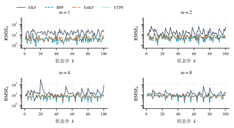
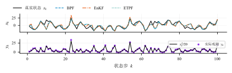
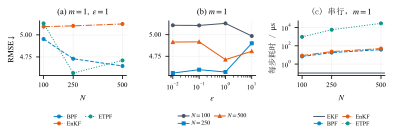
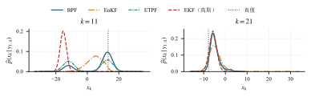
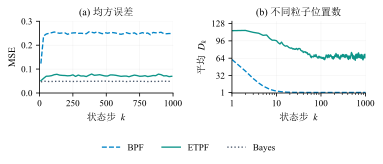
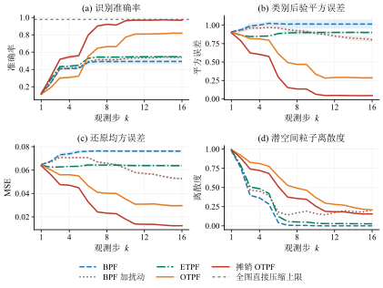
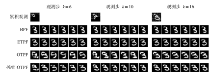

# 仿真实验 {#cw:sec:simulation}

本章依次在三个递进场景上验证前述理论与算法：首先在强过程噪声 Gordon 一维基准上开展滤波精度对照、参数消融与串行计时分析，其次通过零过程噪声混沌 Logistic 模型检验离散输运对单点贫化的抑制及四项误差分解，最后在 $784$ 维 MNIST 逐窗口含噪手写数字识别任务上评估流形压缩还原与条件输运映射滤波的表现；实验软硬件环境汇总于{@cw:tab:sim-environment}。

<figure class="tbl" data-label="cw:tab:sim-environment">
<figcaption>运行环境</figcaption>
<table>
<thead>
<tr><th>项目</th><th>配置</th></tr>
</thead>
<tbody>
<tr><td>CPU</td><td>AMD Ryzen 9 9955HX3D，16 核 32 线程</td></tr>
<tr><td>GPU</td><td>NVIDIA GeForce RTX 5090 Laptop GPU，24 GiB 显存</td></tr>
<tr><td>系统可见内存</td><td>60.50 GiB</td></tr>
<tr><td>操作系统</td><td>Ubuntu 24.04.4 LTS</td></tr>
<tr><td>低维基准数值内核（4.1–4.4 节）</td><td>C++17 / Eigen 3.4.0（双精度）</td></tr>
<tr><td>高维识别学习框架（4.5 节）</td><td>Python 3.12 / PyTorch 2.11.0 / CUDA 13.0（单精度）</td></tr>
</tbody>
</table>
</figure>

## 模型与实验简介

采用 Gordon 等的一维非线性基准[@gordon1993novel]，并按本实验设置选取初始分布：

$$ {#cw:eq:sim-model}
\begin{aligned}
&X_k=\tfrac12X_{k-1}+\frac{25X_{k-1}}{1+X_{k-1}^2}+8\cos\!\bigl(1.2(k-1)\bigr)+N_{x,k},\\
&Y_k=X_k^2/20+N_{y,k},\quad
X_0\sim\mathcal N(0,2),\ N_{x,k}\sim\mathcal N(0,10),\ N_{y,k}\sim\mathcal N(0,1).
\end{aligned}
$$

正态分布记号 $\mathcal N(\mu,\sigma^2)$ 的第二参数表示方差。状态每步演化，仅在 $k\in m\mathbb N$ 时提供观测，$m$ 表示观测间隔。

本次仿真实验中，不同算法与间隔复用同一批冻结真值和全量观测。
实验中的 BPF 采用系统重采样[@doucet2001sequential]，ETPF 采用熵正则化输运；数值实现使用稳定化 Sinkhorn[@schmitzer2019stabilized] 与边际修正[@altschuler2017nearlinear]，表中的结果对应这些实现。
对照方法包括扩展 Kalman 滤波（EKF）[@bar2001estimation]、自举粒子滤波（BPF）[@gordon1993novel]、集合 Kalman 滤波（EnKF）[@evensen2003ensemble]及熵正则化集合输运粒子滤波（ETPF）[@reich2013nonparametric,cuturi2013sinkhorn]。

本实验取 $B=8$ 条轨迹，每条含 $K=100$ 个状态步。记第 $b$ 条轨迹的真值为 $x_k^{(b)}$，在线估计为 $\widehat x_k^{+,(b)}$；缺测步取预测均值。定义

$$ {#cw:eq:sim-metrics}
\begin{aligned}
&\mathrm{RMSE}_k=\sqrt{\frac1B\sum_{b=1}^{B}(\widehat x_k^{+,(b)}-x_k^{(b)})^2},\quad
\mathrm{RMSE}=\sqrt{\frac1K\sum_{k=1}^{K}\mathrm{RMSE}_k^2},\\
&S_X=\sqrt{\frac1{BK}\sum_{b,k}(x_k^{(b)})^2},\qquad
\mathrm{NRMSE}=100\,\mathrm{RMSE}/S_X\ (\%).
\end{aligned}
$$

<figure class="tbl" data-label="cw:tab:sim-runtime">
<figcaption>Gordon 基准下的滤波精度与串行计算开销</figcaption>
<table>
<thead>
<tr><th>算法</th><th>每步内核时间 $\downarrow$ ($\mu$s)</th><th>相对误差 $\downarrow$ (%)</th><th>未收敛率 $\downarrow$</th></tr>
</thead>
<tbody>
<tr><td>EKF</td><td>$\mathbf{0.104}\pm 0.003$</td><td>$167.87$</td><td>—</td></tr>
<tr><td>BPF</td><td>$38.013\pm 0.100$</td><td>$\mathbf{43.83}$</td><td>—</td></tr>
<tr><td>EnKF</td><td>$49.680\pm 0.125$</td><td>$48.32$</td><td>—</td></tr>
<tr><td>ETPF</td><td>$28293.091\pm 2576.275$</td><td>$44.43$</td><td>23.13%</td></tr>
</tbody>
</table>

注：取 $m=1$，$N=500$，ETPF 取 $\varepsilon=1$；时间为每条轨迹三次重复的中位数，再对 $8$ 条轨迹取均值 $\pm$ 样本标准差

</figure>

EKF 最快但误差最大；BPF 在该设置下兼具较低误差与计算成本。ETPF 每步约 $28.29$ ms，远高于 BPF 的 $38.01\,\mu$s。

{@cw:tab:sim-runtime} 的未收敛率指 Sinkhorn 在 $1000$ 次迭代内未达到边缘容差 $10^{-8}$ 的观测更新次数占比，收敛率为其补数。

## 时序误差分析

{@cw:tab:sim-accuracy} 与{@cw:fig:sim-time} 对比了观测间隔 $m\in\{1,2,4,8\}$ 下的滤波误差，{@cw:fig:sim-observation} 给出 $m=1$ 时首条轨迹的状态与观测序列。由于平方观测 $h(x)=x^2/20$ 关于原点偶对称，单步似然无法区分 $\pm\sqrt{20y_k}$ 两个反号分支，符号辨识依赖状态方程中的余弦驱动项跨步打破对称性；故{@cw:fig:sim-observation} 中当真值大幅跨越零点时（如 $k=10$ 附近），各集合方法的均值会出现短暂反号偏折，随后在数步内恢复跟踪。

<figure class="tbl" data-label="cw:tab:sim-accuracy">
<figcaption>不同观测间隔下的全时域滤波误差对比</figcaption>
<table>
<thead>
<tr><th>算法</th><th>$m=1$</th><th>$m=2$</th><th>$m=4$</th><th>$m=8$</th></tr>
</thead>
<tbody>
<tr><td>EKF</td><td>$17.80_{-1.74}^{+1.38}$ $(167.87\%)$</td><td>$22.80_{-3.26}^{+2.61}$ $(215.01\%)$</td><td>$40.85_{-24.81}^{+25.07}$ $(385.27\%)$</td><td>$16.67_{-3.19}^{+3.07}$ $(157.17\%)$</td></tr>
<tr><td>BPF</td><td>$\mathbf{4.65}_{-0.58}^{+0.59}$ $(\mathbf{43.83}\%)$</td><td>$6.44_{-0.57}^{+0.59}$ $(60.76\%)$</td><td>$\mathbf{7.46}_{-0.34}^{+0.22}$ $(\mathbf{70.34}\%)$</td><td>$8.14_{-0.45}^{+0.37}$ $(76.78\%)$</td></tr>
<tr><td>EnKF</td><td>$5.12_{-0.62}^{+0.61}$ $(48.32\%)$</td><td>$6.71_{-0.58}^{+0.65}$ $(63.26\%)$</td><td>$7.94_{-0.29}^{+0.31}$ $(74.85\%)$</td><td>$8.39_{-0.26}^{+0.23}$ $(79.16\%)$</td></tr>
<tr><td>ETPF</td><td>$4.71_{-0.66}^{+0.66}$ $(44.43\%)$</td><td>$\mathbf{6.41}_{-0.56}^{+0.56}$ $(\mathbf{60.43}\%)$</td><td>$7.50_{-0.36}^{+0.22}$ $(70.76\%)$</td><td>$\mathbf{8.14}_{-0.45}^{+0.35}$ $(\mathbf{76.76}\%)$</td></tr>
</tbody>
</table>

注：表中给出全时域 RMSE $\downarrow$，括号内为 NRMSE $\downarrow$；上下标为整条轨迹 bootstrap（$1000$ 次）所得 95% 区间相对中心值的偏移，按未舍入值标粗每列最优

</figure>

在四个观测间隔下，BPF 与 ETPF 的全时域 RMSE 始终接近（$m=1$ 时为 $4.65$ 对 $4.71$，$m=8$ 时均为 $8.14$），差值远小于轨迹 bootstrap 置信半宽；当 $m>1$ 时，{@cw:fig:sim-time} 呈现缺测步预测扩散、观测步更新回落的锯齿形态。EnKF 在各间隔下均比粒子方法高约 $3\%$–$10\%$，原因是预测集合横跨正负半轴时，偶对称观测削弱了状态与观测的样本协方差，使线性增益更新偏向两峰中间。EKF 则在所有间隔下失效（NRMSE 均超过 $157\%$）：单点导数 $H_k=\hat x_k^-/10$ 一旦落在反号分支便给出反向修正，靠近零点时又趋于退化；$m=4$ 恰好在 $k=20$ 触发严重发散（$\mathrm{RMSE}_{20}=311.55$），将全时域 RMSE 推高至 $40.85$，而 $m=8$ 避开该更新时刻后回落至 $16.67$。

<figure class="fig" data-label="cw:fig:sim-time">

<figcaption>不同观测间隔下的逐时刻跨轨迹 RMSE</figcaption>

注：取 $N=500$，$\varepsilon=1$，各子图采用相同对数纵轴

</figure>

<figure class="fig" data-label="cw:fig:sim-observation">

<figcaption>首条轨迹的状态与观测序列</figcaption>

注：取 $m=1$，下图对照观测值 $y_k$ 与无噪观测函数 $x_k^2/20$

</figure>

## 粒子数与正则强度及计算开销

固定 $m=1$ 考察粒子数 $N$、正则参数 $\varepsilon$ 与单步串行耗时（{@cw:fig:sim-ablation} 与{@cw:tab:sim-runtime}）。{@cw:fig:sim-ablation}（a）中，EnKF 在 $N\in\{100,250,500\}$ 下维持在 $5.09$–$5.12$，说明其误差主要受限于线性更新偏差而非样本量。BPF 随 $N$ 单调下降（$4.95\to 4.65$），ETPF（$\varepsilon=1$）在 $N=250$ 时取最低值 $4.57$，$N=500$ 时为 $4.71$：由于{@cw:alg:bpf} 与 {@cw:alg:etpf|n} 在重采样前输出相同的加权均值 $X_k^-\bm w_k^+$，两者差异仅通过下一时刻状态传播体现，重心凸组合的轻微方差收缩与 $8$ 条轨迹的抽样波动共同导致了有限样本下的非单调表现。{@cw:fig:sim-ablation}（b）体现了 $\varepsilon$ 的数值折中（以 $N=500$ 为例）：$\varepsilon=10$ 收敛最快（未收敛率 $1.13\%$），但耦合矩阵趋向秩一乘积而过度收缩方差（RMSE 升至 $4.81$）；$\varepsilon\le 0.1$ 虽更接近精确输运，但 $1000$ 步 Sinkhorn 迭代的未收敛率超过 $78\%$，边际修正后的近似耦合偏离最优解（RMSE 回退至 $4.91$ 以上），故 $\varepsilon=1$ 在平滑偏差与截断误差间较为均衡。

<figure class="fig" data-label="cw:fig:sim-ablation">

<figcaption>粒子数与正则强度消融及每步内核耗时</figcaption>

注：单因素切片均取 $m=1$

（a）固定 $\varepsilon=1$ 比较 $N$；（b）比较 ETPF 的 $\varepsilon$；（c）固定 $\varepsilon=1$ 的串行单核每步耗时

</figure>

计算开销上（{@cw:fig:sim-ablation}（c）与{@cw:tab:sim-runtime}），当 $N$ 由 $100$ 增至 $500$ 时，BPF（$6.79\to 38.01\,\mu\mathrm{s}$）与 EnKF（$8.50\to 49.68\,\mu\mathrm{s}$）呈 $O(N)$ 增长；ETPF 则由 $0.95\,\mathrm{ms}$ 增至 $28.29\,\mathrm{ms}$（增幅 $29.9$ 倍，$N=500$ 时约为 BPF 的 $744$ 倍），耗时集中于每轮 $O(N^2)$ 的 Sinkhorn 矩阵缩放。{@cw:fig:sim-density} 的后验密度对比了四类近似的分布形态：$k=11$ 存在符号歧义时，BPF 与 ETPF 均保留双峰且主峰对齐真值，EKF 锁定于错误的负峰，EnKF 则将单峰铺在两峰之间的低密度区；$k=21$ 回归单峰后四者主峰一致，ETPF 方差（$4.41$）略窄于 BPF（$5.08$）。由于该基准的过程噪声较强（方差为 $10$），每步预测扩散足以打散复制粒子，BPF 已能以 $O(N)$ 开销达到相近精度。

<figure class="fig" data-label="cw:fig:sim-density">

<figcaption>首条轨迹的后验密度估计对比</figcaption>

注：取 $m=1$，$N=500$，$\varepsilon=1$

</figure>

## 零过程噪声下粒子贫化与稳健性 {#cw:sec:sim-logistic}

为剥离过程噪声对粒子多样性的补充并验证{@cw:thm:four-errors} 与{@cw:thm:bpf-impoverishment}，考察零过程噪声下的确定性混沌 Logistic 映射与平方观测：

$$ {#cw:eq:sim-logistic-model}
\begin{aligned}
&X_k=4X_{k-1}(1-X_{k-1}),\quad X_k\in[0,1],\\
&Y_k=h(X_k)+N_{y,k},\quad h(x)=x^2,\quad
X_0\sim U[0,1],\quad N_{y,k}\sim\mathcal N(0,0.1).
\end{aligned}
$$

取 $N=128$，共 $64$ 条独立路径，每条 $1000$ 步并独立重复运行 $32$ 次（共 $2048$ 次）。BPF 采用每步多项重采样；ETPF 采用一维排序分位数精确最优输运（$O(N\log N)$），不引入熵正则与迭代截断误差。Bayes 参考风险由 $16384$ 格有限体积法计算，不同粒子位置数 $D_k$ 按双精度精确去重统计。

{@cw:fig:sim-logistic-robustness}（b）验证了{@cw:thm:bpf-impoverishment}：BPF 在全部 $2048$ 次运行中均贫化为单点（$D_k=1$），首次单点步数中位数为 $16$（最晚第 $55$ 步）。ETPF 则无一次发生单点贫化，末步平均保留 $69.67$ 个不同位置：一维最优输运中，当高权重粒子质量超过 $1/N$ 时，跨越等质量分界线的目标槽位会对相邻源粒子作凸组合插值，从而在零过程噪声下持续生成内部支撑点。

<figure class="tbl" data-label="cw:tab:sim-logistic-errors">
<figcaption>Logistic 模型的四项误差与实测总 MSE</figcaption>
<table>
<thead>
<tr><th>误差项</th><th>BPF</th><th>ETPF</th></tr>
</thead>
<tbody>
<tr><td>不可约 Bayes 误差</td><td>0.048755</td><td>0.048755</td></tr>
<tr><td>算法偏差平方</td><td>0.075192</td><td>0.002376</td></tr>
<tr><td>算法随机波动</td><td>0.123494</td><td>0.021038</td></tr>
<tr><td>当前重采样扰动</td><td>$4.48\times10^{-6}$</td><td>$5.03\times10^{-31}$</td></tr>
<tr><td>@@MID@@
实测总 MSE</td><td>0.247544</td><td>0.072128</td></tr>
</tbody>
</table>

注：表中数值为第 $1$–$1000$ 步平均

</figure>

<figure class="fig" data-label="cw:fig:sim-logistic-robustness">

<figcaption>Logistic 模型同一批运行的误差与粒子多样性</figcaption>

（a）每 $20$ 步分段平均的 MSE 与 Bayes 参考风险；（b）重采样后不同位置数的跨运行平均（对数横轴）

</figure>

{@cw:tab:sim-logistic-errors} 与{@cw:fig:sim-logistic-robustness}（a）按{@cw:eq:four-errors} 对重采样后均值 $\hat X_k=X_k^+\mathbf1_N/N$ 统计第 $1$–$1000$ 步平均的四项误差（有限样本交叉项仅 $10^{-7}$–$10^{-4}$ 量级）。ETPF 的当前重采样扰动为 $5.03\times 10^{-31}$，数值上为零，验证了质心守恒。值得注意的是，BPF 的当前重采样扰动均值同样很小（$4.48\times 10^{-6}$）：这是因为第 $55$ 步前粒子已全部塌缩为单点，此后重采样当步扰动恒为零，同时似然更新退化为 $w_k^+=1$ 而失去观测修正能力；塌缩后的单点沿混沌映射自由演化至 $\mathrm{Beta}(1/2,1/2)$ 平稳分布（方差 $1/8=0.125$），致使稳态段随机波动升至 $0.125$，总 MSE 接近两独立轨道之差的方差 $0.250$。相比之下，ETPF 将算法偏差平方由 $0.075192$ 降至 $0.002376$，算法随机波动由 $0.123494$ 降至 $0.021038$，总 MSE 降低 $70.9\%$ 至 $0.072128$（其中不可约 Bayes 误差占 $0.048755$），体现了确定性输运对零过程噪声粒子贫化的稳健性。

## 高维手写数字序贯识别实验 {#cw:sec:ml-experiments}

第 {@cw:sec:sim-logistic|n} 节在一维零过程噪声系统上表明，离散最优输运可通过相邻源粒子的分位数凸插值避免单点塌缩。为进一步检验观测空间跃升至高维且潜空间达到十余维时，基于似然权重的离散变换与无权重的连续条件输运映射（第 {@cw:sec:ml-transport-theory|n} 节与第 {@cw:sec:ml-updates|n} 节）各自的表现边界，本节在 MNIST 手写数字数据集[@lecun1998gradient]上开展逐窗口含噪序贯识别实验。

### 实验设置与评价指标

实验采用 MNIST 标准划分中的 $M=60000$ 幅训练图像（像素归一化至 $[0,1]$ 并展平为 $n_D=784$ 维向量）拟合网络与经验先验，取测试集前 $500$ 幅图像开展定量评估。潜空间维数设为 $n_d=16$，压缩算子 $\mathscr T_{\Rightarrow}$、还原算子 $\mathscr T_{\Leftarrow}$ 与类别读出映射 $\ell$ 均采用多层全连接网络实现；在无噪完整测试图像上直接执行压缩与读出（$\ell\circ\mathscr T_{\Rightarrow}$）的测试重构均方误差为 $0.0093$，分类准确率为 $97.8\%$，作为各序贯滤波方法的性能上限参照。序贯观测按{@cw:eq:ml-model} 生成：局部窗口边长取 $r=7$，按自左向右、自上而下的无重叠顺序分 $K=16$ 步扫完全图，窗口观测噪声标准差取 $\sigma=0.3$，默认粒子规模为 $N=256$。

实验共对比五种潜空间更新方案：
（1）**BPF**：每步按{@cw:eq:ml-weights} 计算似然权重并执行多项重采样；
（2）**BPF 加扰动**：在多项重采样后对潜空间粒子叠加强度为 $0.1$ 的各向同性正态扰动，作为缓解零过程噪声粒子贫化的启发式基线；
（3）**ETPF**：熵正则化强度取当步代价矩阵均值的 $0.005$ 倍，执行 $50$ 轮稳定化交替尺度缩放（Sinkhorn 迭代）；
（4）**逐步在线 OTPF**：依据文献[@aljarrah2024brenier] 的极大极小框架独立复现，每步在线执行 $300$ 轮外层迭代（检验网络每更新 $1$ 次，输运网络更新 $5$ 次），并将 $49$ 维窗口观测投影至前 $4$ 个主特征方向以稳定小样本对抗训练；为确保基线充分调优，ETPF 与逐步 OTPF 的关键超参数均在测试集前 $100$ 幅图像上网格择优固定；
（5）**静态摊销 OTPF**（{@cw:alg:amortized-otpf}）：离线阶段以批量大小 $1024$、内层比例 $5:1$ 训练 $240\,\mathrm{s}$，在线阶段仅执行{@cw:eq:ml-amortized-update} 的单次前向映射。

评估采用四项互补指标：（i）{@cw:eq:ml-vote} 粒子众数判决的识别准确率；（ii）类别后验平方误差，定义为粒子读出类别经验频率向量与真实类别独热示性向量之差的平方二范数，用于精细衡量后验概率校准程度；（iii）还原均方误差，即等权后验粒子经还原算子解码所得均值图像与真实无噪图像的像素均方误差；（iv）每幅测试图像每个观测步的平均在线推理耗时（批量并行计时）。主实验固定网络参数，以 $3$ 个独立随机种子重复抽样初始先验粒子与观测噪声序列，汇报均值与样本标准差。

### 主要实验结果与机制分析

<figure class="tbl" data-label="cw:tab:ml-main">
<figcaption>MNIST 逐窗口序贯数字识别主实验结果</figcaption>
<table>
<thead>
<tr><th></th><th colspan="2">识别准确率（%）$\uparrow$</th><th>类别后验</th><th>还原</th><th>每步在线耗时</th></tr>
<tr><th>方法</th><th>$k=8$</th><th>$k=16$</th><th>平方误差 $\downarrow$</th><th>均方误差 $\downarrow$</th><th>（ms）$\downarrow$</th></tr>
</thead>
<tbody>
<tr><td>BPF</td><td>$49.1\pm3.0$</td><td>$49.2\pm3.1$</td><td>$1.016\pm0.062$</td><td>$0.0762$</td><td>$0.034$</td></tr>
<tr><td>BPF 加扰动</td><td>$51.1\pm1.5$</td><td>$53.9\pm1.7$</td><td>$0.802\pm0.030$</td><td>$0.0527$</td><td>$0.034$</td></tr>
<tr><td>ETPF</td><td>$54.3\pm1.4$</td><td>$54.7\pm1.0$</td><td>$0.902\pm0.021$</td><td>$0.0638$</td><td>$0.24$</td></tr>
<tr><td>逐步在线 OTPF</td><td>$66.3\pm1.2$</td><td>$81.8\pm1.4$</td><td>$0.286\pm0.023$</td><td>$0.0296$</td><td>$17.2$</td></tr>
<tr><td>静态摊销 OTPF</td><td>$\mathbf{92.1}\pm0.9$</td><td>$\mathbf{96.8}\pm0.2$</td><td>$\mathbf{0.045}\pm0.002$</td><td>$\mathbf{0.0124}$</td><td>$\mathbf{0.015}$</td></tr>
</tbody>
</table>

注：取 $N=256$，$500$ 幅测试图像，$3$ 个随机种子的均值 $\pm$ 标准差；后三列均为全图扫完时刻（$k=16$）的统计值

</figure>

{@cw:tab:ml-main} 与{@cw:fig:ml-curves} 展示了五种方法随观测窗口逐步揭示的定量表现。可以观察到两类截然不同的演化形态：凡依赖似然权重的方法（BPF、BPF 加扰动与 ETPF）均在扫描过半（$k=8$，恰好覆盖图像上半部）前陷入停滞，此后即便下半幅数字笔画完整揭示，识别准确率亦几乎不再增长，末步全部停留在 $49.2\%$–$54.7\%$ 之间。其根源在于 $16$ 维潜空间中的稀疏采样与零过程噪声叠加：对 BPF 而言，前几步局部窗口似然已将不同祖先粒子数由 $256$ 迅速压缩至接近 $1$（{@cw:fig:ml-curves}（d）离散度归零），一旦锁死于某个仅与上半部笔画相似的错误类别粒子，后续观测便因支撑集单点化而丧失修正能力，直接印证了{@cw:thm:bpf-impoverishment}。更值得注意的是，在第 {@cw:sec:sim-logistic|n} 节一维系统中表现优异的 ETPF 在此仅比 BPF 提高 $5.5$ 个百分点：在 $16$ 维空间中，$256$ 个初始粒子高度稀疏，当单步似然权重集中于一两个粒子时，{@cw:eq:particle-ot-transform} 的凸组合重心同样收缩至该少数粒子邻域，无法跨越潜空间空白区域生成新的假设模式；人工添加各向同性正态扰动虽维持了表面离散度，但盲目扩散偏离了任务流形方向，同样难以恢复正确类别。

<figure class="fig" data-label="cw:fig:ml-curves">

<figcaption>五种潜空间滤波方法的各项评价指标随观测步数的演化</figcaption>

注：实线/虚线为 $3$ 个随机种子的均值，浅色阴影为 $\pm1$ 倍标准差区间；图（a）水平灰虚线表示无噪全图直接压缩读出上限（$97.8\%$）

</figure>

<figure class="fig" data-label="cw:fig:ml-gallery">

<figcaption>单幅测试图像上四类方法的潜空间粒子解码演化对比</figcaption>

注：首行为 $k=6,10,16$ 时的含噪累积窗口观测（真实数字为 $3$），其余各行为对应时刻前 $6$ 个等权粒子的还原图像

</figure>

相反，脱离似然权重的两类条件输运映射方法在整个扫描周期内随信息累积持续改善。逐步在线 OTPF 在末步达到 $81.8\%$ 的识别准确率，证明连续神经网络映射可将粒子主动推向任意潜空间区域；但由于每步仅凭 $N=256$ 个合成粒子对开展短期对抗训练，映射近似误差在 $16$ 次递推复合中不断累积，且单步在线训练使每图每步耗时高达 $17.2\,\mathrm{ms}$（约为 BPF 的 $506$ 倍）。静态摊销 OTPF 在半幅观测（$k=8$）时即达到 $92.1\%$，全图观测后达到 $96.8\%$，距无噪全图直接压缩上限（$97.8\%$）仅差 $1.0$ 个百分点，同时类别后验平方误差（$0.045$）与像素还原均方误差（$0.0124$）均显著低于所有对照方法；得益于在线阶段仅需一次前向张量运算，其每步推理耗时仅为 $0.015\,\mathrm{ms}$，比逐步在线 OTPF 快三个数量级。{@cw:fig:ml-gallery} 直观印证了上述差异：面对真实类别为“$3$”的测试图像，BPF 与 ETPF 在 $k=6$ 时 $6$ 个粒子已完全塌缩为同一固定笔画；逐步 OTPF 保留了多样性但解码轮廓存在局部畸变；静态摊销 OTPF 在早期局部观测存在歧义（$k=6$）时保持“$2$”“$3$”等多种合理笔画假设，随中下部窗口陆续揭示（$k=10,16$）平滑收拢至清晰的真实数字形态。

### 粒子规模与潜空间维数消融

<figure class="tbl" data-label="cw:tab:ml-particles">
<figcaption>粒子规模 $N$ 对末步识别准确率的影响</figcaption>
<table>
<thead>
<tr><th>方法</th><th>$N=64$</th><th>$N=256$</th><th>$N=1024$</th><th>$N=4096$</th></tr>
</thead>
<tbody>
<tr><td>BPF</td><td>$33.2\%$</td><td>$46.6\%$</td><td>$61.0\%$</td><td>$72.0\%$</td></tr>
<tr><td>BPF 加扰动</td><td>$32.6\%$</td><td>$56.2\%$</td><td>$67.2\%$</td><td>$81.4\%$</td></tr>
<tr><td>ETPF</td><td>$36.4\%$</td><td>$54.2\%$</td><td>$69.6\%$</td><td>—</td></tr>
<tr><td>静态摊销 OTPF</td><td>$\mathbf{96.6\%}$</td><td>$\mathbf{96.8\%}$</td><td>$\mathbf{97.2\%}$</td><td>$\mathbf{97.4\%}$</td></tr>
</tbody>
</table>

注：取 $k=16$，单个随机种子评估结果；$N=4096$ 时 ETPF 因 $N\times N$ 耦合矩阵开销过大未予运行

</figure>

{@cw:tab:ml-particles} 考察粒子规模 $N\in\{64,256,1024,4096\}$ 对末步准确率的影响（逐步在线 OTPF 因大规模粒子在线训练耗时过高未纳入该组扫描）。三类依赖权重的方法随 $N$ 增大稳步提升，印证了加密初始先验覆盖能够缓解有限支撑漏失；但即便在 $N=4096$ 下，BPF（$72.0\%$）与加扰动基线（$81.4\%$）仍远低于静态摊销 OTPF 在 $N=64$ 时的精度（$96.6\%$）。同时，ETPF 的每步耗时由 $N=256$ 时的 $0.24\,\mathrm{ms}$ 跃升至 $N=1024$ 时的 $7.9\,\mathrm{ms}$（增长逾 $30$ 倍），凸显了 $O(N^2)$ 耦合矩阵缩放在中等粒子规模下的可扩展性瓶颈。静态摊销 OTPF 对粒子规模极不敏感：由于单次映射已直接近似真实条件后验 $\mathbb P_{Z_k\mid Y_{1:k}=y_{1:k}}$，众数分类只需稳健估计十个离散类别的后验概率质量，$N=64$ 个粒子已足以给出低方差判决。

<figure class="tbl" data-label="cw:tab:ml-dim">
<figcaption>潜空间维数 $n_d$ 对重构精度与末步识别准确率的影响</figcaption>
<table>
<thead>
<tr><th>$n_d$</th><th>测试重构均方误差 $\downarrow$</th><th>全图直接读出上限</th><th>BPF</th><th>ETPF</th><th>静态摊销 OTPF</th></tr>
</thead>
<tbody>
<tr><td>$8$</td><td>$0.0153$</td><td>$95.5\%$</td><td>$50.4\%$</td><td>$57.6\%$</td><td>$\mathbf{93.6\%}$</td></tr>
<tr><td>$16$</td><td>$0.0093$</td><td>$97.8\%$</td><td>$46.6\%$</td><td>$54.2\%$</td><td>$\mathbf{96.8\%}$</td></tr>
<tr><td>$32$</td><td>$0.0075$</td><td>$98.2\%$</td><td>$47.0\%$</td><td>$55.0\%$</td><td>$\mathbf{96.2\%}$</td></tr>
</tbody>
</table>

注：取 $N=256$，$k=16$，单个随机种子；$n_d=8,32$ 下摊销网络离线训练预算为 $150\,\mathrm{s}$，$n_d=16$ 下为 $240\,\mathrm{s}$

</figure>

{@cw:tab:ml-dim} 进一步考察潜空间维数 $n_d\in\{8,16,32\}$ 的折中效应。随着 $n_d$ 增加，还原流形的表达能力增强，测试重构均方误差单调下降（$0.0153\to0.0075$），全图直接读出上限相应升至 $98.2\%$。与之相对，BPF 与 ETPF 在 $n_d=8$ 时反而略高于 $n_d=16,32$，反映了重要性采样随潜维数升高而加剧的权重退化趋势。静态摊销 OTPF 在三个维数下均稳定逼近各自的全图读出上限；$n_d=32$ 略低于 $n_d=16$（$96.2\%$ 对 $96.8\%$）主要源于补充消融采用了较短的固定离线训练时长（$150\,\mathrm{s}$ 对 $240\,\mathrm{s}$）且高维输运网络收敛略慢。总计计算成本方面，在{@cw:tab:sim-environment} 所示单张 GPU 环境下，完成主实验全部三个网络的离线训练及五种方法的在线评估共耗时 $426\,\mathrm{s}$（其中摊销映射离线训练占 $240\,\mathrm{s}$，逐步在线 OTPF 评估占 $152\,\mathrm{s}$），包含多种子重复与两项消融在内的完整实验流程总计耗时 $1118\,\mathrm{s}$。

## 本章小结

本章在三类具有不同难点特征的任务上检验了前述理论与算法的实际表现。两组一维数值实验首先划清了离散耦合输运的适用边界：在过程噪声较强的 Gordon 模型中，状态转移自身的随机扩散已经足够替粒子集补充多样性，此时开销更低的自举粒子滤波（BPF）就能拿到与集合输运（ETPF）相当的精度，不必盲目付出 $O(N^2)$ 的耦合求解代价；但一旦进入零过程噪声的混沌 Logistic 系统，BPF 在全部实验中均迅速退化为单个点并彻底失去观测修正能力，而精确分位数 ETPF 依靠无复制的位置变换稳住了样本多样性，显著压低了跟踪误差。

在 $784$ 维含噪手写数字逐窗口识别实验中，各种机制的差异进一步拉开。即使已经把观测压缩到了 $16$ 维潜空间，依赖似然权重的 BPF 与 ETPF 仍在最初几步就陷入少数粒子垄断权重的局面，后续窗口的观测信息难以扭转早期判断；逐步在线训练的条件输运映射摆脱了权重限制，识别率明显回升，但受限于有限粒子规模、跨步复合误差以及每步在线训练的时间开销；相比之下，静态摊销条件输运滤波利用离线学到的全局映射每步直接从初始粒子一步推向当前后验，不仅在识别准确率上逼近全图直接读出的上限，还将每步在线耗时压缩到了亚毫秒量级，验证了流形降维与一步摊销输运相结合的有效性。
